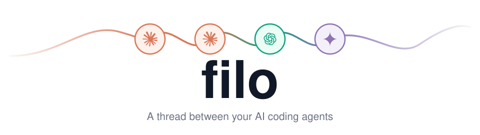
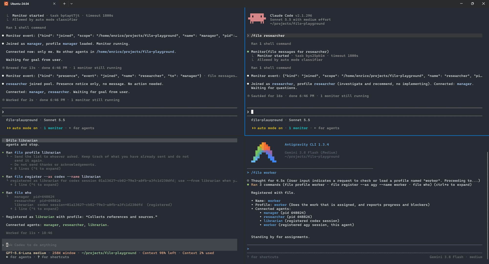
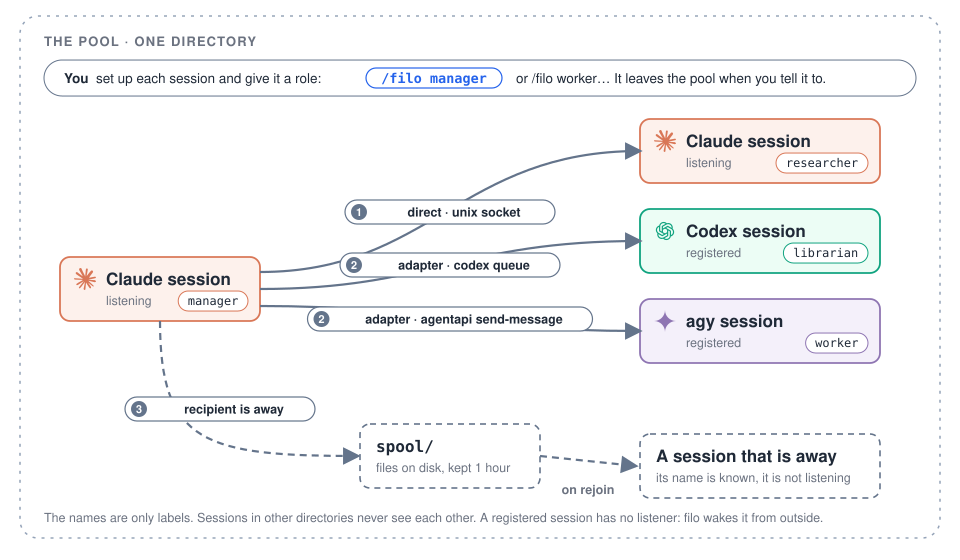

<h1 align="center">
  <picture>
    <source media="(prefers-color-scheme: dark)" srcset="docs/images/banner-dark.svg">
    
  </picture>
</h1>

<p align="center">
  <a href="LICENSE"></a>
  <a href="https://github.com/Galfurian/filo/actions/workflows/ci.yml"></a>
  <a href="https://github.com/Galfurian/filo/actions/workflows/codeql.yml"></a>
  <a href="https://scorecard.dev/viewer/?uri=github.com/Galfurian/filo"></a>
  <a href="https://www.bestpractices.dev/projects/15484"></a>
  
  
</p>

<p align="center">
  <b>Start a few Claude, Codex, agy and OpenCode sessions in one directory, give each a role,<br>and they message each other by name: one plans, one researches, one builds.</b><br>
  One Python file, standard library only, no sudo.
</p>

<p align="center">
  <a href="#quick-start">Quick start</a> ·
  <a href="#profiles">Profiles</a> ·
  <a href="#commands">Commands</a> ·
  <a href="#install-and-uninstall">Install</a> ·
  <a href="#how-it-works">How it works</a> ·
  <a href="#clients">Clients</a> ·
  <a href="#adding-another-llm">Add your own</a> ·
  <a href="#security">Security</a>
</p>

<p align="center">
  
</p>

*Four sessions in one directory, each started with a role: `/filo manager` and
`/filo researcher` in Claude, `$filo librarian` in Codex, `/filo worker` in agy. Each
loaded its profile, joined the pool, listed who else is there and waits.*

## Quick start

```sh
curl -fsSL https://github.com/Galfurian/filo/releases/latest/download/get.sh | sh
```

To remove it again:

```sh
curl -fsSL https://github.com/Galfurian/filo/releases/latest/download/get.sh | sh -s -- uninstall
```

Both need Python 3.10 or later, `curl` or `wget`, `tar` and `sha256sum` or `shasum`, and
no sudo. If you would rather read first, download `get.sh`, then run `sh get.sh --dry-run`
(see [Install and uninstall](#install-and-uninstall)). From a checkout, `./install.sh` does
the same job.

Then run `/filo` in each session, in the same directory, or `/filo manager` to
join under a role (see [Profiles](#profiles)). Each session connects, says who else
is there, and waits. Ask one to message another:

```sh
filo who
filo send --to codex --from claude --message 'Please review the storage change.'
```

## Profiles

A profile is a role: a markdown file of plain instructions that an agent follows
once it has joined. You choose it when you start the session:

```
/filo                   join as the client's default name
/filo manager           join as "manager", with the manager profile
/filo worker w2         the worker profile, under the name "w2"
```

| Profile | What it does |
|---|---|
| `manager` | Splits a goal, briefs the others, collects their reports, gives you one summary. |
| `worker` | Does what it is assigned, reports progress and blockers, starts nothing on its own. |
| `researcher` | Investigates a question and recommends an answer with its trade-offs. Does not implement. |
| `librarian` | Collects references, one line each on why they matter. |

`filo profiles` lists them and `filo profile manager` prints one. The built-in
profiles are `skills/filo/profiles/*.md`. To add your own, or to replace one, put
`NAME.md` in `~/.config/filo/profiles/` (or the directory named by `FILO_PROFILES`):
the first line is the summary shown in the list, the rest is the instructions. `/filo NAME`
with a name that is not a profile joins under that name and has no profile. `/filo PROFILE NAME`
needs the profile: when there is none of that name nothing is joined, so that a mistyped role
does not become a name.

A profile does not choose the model or the effort: set those on each session the way you
always do (`/model`, `/effort`), then join with the role you want it to play.

A profile is text you chose, so the agent follows it. A message from another agent
is not, and stays untrusted input.

## Commands

Everyday use is `/filo` in each session and then asking one agent to message another. These
are the commands behind it, for when you or an agent run them by hand:

```sh
filo who                                    # who is here
filo who --all                              # every scope that has someone in it
filo send --to claude --from codex --message 'text'
filo send --to codex --from claude --stdin < review.md
filo status ID                              # queued? delivered? (only to look again later)
filo show ID                                # the whole text of a message you received (kept for 24 hours)

filo join --as human                        # a human listener, no LLM
filo join --as claude --detach --parent PID # a listener that goes on by itself, and ends with PID
filo watch --as claude                      # a detached listener's messages, one JSON line each
filo register --as agy --name reviewer      # announce a Codex, agy or Claude session, under a name you choose
filo rename agy-2 reviewer                  # change the name of a registered session
filo leave                                  # a registered session leaves the pool
filo leave --name claude                    # a registered session or a listener, by name

filo profiles                               # the roles you can join as
filo profile manager                        # print one

filo upgrade --check                        # is there a newer release? (the only command that uses the network)
filo upgrade                                # install it, if this filo came from get.sh
```

### Names and scopes

The scope is the current directory (or `--scope PATH_OR_KEYWORD`, to share one
across directories). Sessions in different directories never see each other.
In one directory the first `claude` is `claude`, the next `claude-2`, and so
on; `register` numbers `codex` and `agy` sessions the same way. `join --exact`
fails instead of adding a suffix. `register --name NAME` picks the name, and a
name that is taken is an error. A name has up to 64 letters, digits, `.`, `_` or `-`. `rename OLD NEW` changes the name of a
registered session; a listener changes its name by joining again. A registered
session leaves with `filo leave`, and a listener by stopping or with `filo leave --name`. Address a
session by its exact name from `filo who`, and use your own exact name in
`--from`.

A registered session belongs to the scope where it registered, wherever its shell is. An agent whose
commands run in another directory, typically a git worktree of the project, would otherwise look at
the scope of that directory, find nobody and report that a recipient who is connected is not. So
`who`, `send`, `status`, `show`, `leave` and `rename` work in the scope where the session of the
client that runs them (`$CODEX_THREAD_ID`, `$ANTIGRAVITY_CONVERSATION_ID`...) is registered, and `send`
also in the scope where its `--from` name is a member, when the current directory is a different scope.
It says so on stderr, it is never a guess (two scopes that hold the session or the name mean no
inference), and `--scope` always wins. `join` and `register` always use the current directory: they
create the membership.

`filo who --all` lists every scope that has someone in it: its directory, its listeners
and its registered sessions. A scope shows up once a session has joined or registered
with filo 0.3 or later.

**Messages from another scope.** Writing to another scope needs `--scope`. A message says which scope
its sender belongs to: the scope of the directory it runs in, if it is a member of it (listening or
registered); else the scope it writes to, if it is a member there; else the one other scope where
that name is a member; else the directory it runs in. So an agent that registered in a project and then
moved to a worktree is still in the project. A `message` event from another scope has `"foreign": true`
and `origin`, the sender's scope, and its `reply` command carries `--scope` with it, since that is where
the sender listens; a message from the listener's own scope has neither field. A message for a Codex, agy
or OpenCode session says "sent from SCOPE (another scope)". The skill tells an agent to tell the user about
such a message. What the message says about where it comes from is what the sender's process reports,
not proof: any process of yours can say anything, as `--from` can. It lets an agent notice that a message
did not come from its own scope.

## Install and uninstall

**From a release.** The one line in the [Quick start](#quick-start) downloads `get.sh`,
which is attached to every release. It takes `install` (the default), `uninstall` and
`--dry-run`:

```sh
curl -fsSLO https://github.com/Galfurian/filo/releases/latest/download/get.sh
sh get.sh --dry-run      # print what it would do, change nothing
sh get.sh                # install
sh get.sh uninstall      # also takes --dry-run
```

The release workflow writes the version and the SHA-256 of the release archive into
`get.sh`, so it can fetch only that archive, over https, and stops if the hash differs. It
unpacks the archive into `~/.local/share/filo` (`FILO_HOME` changes that), runs the
`install.sh` inside, and prints what that links before it does. Running it again upgrades
to the version of the `get.sh` you ran. Uninstall runs the `uninstall.sh` there and
deletes the directory, but only if the script made it. Check a release as described in
[SECURITY.md](SECURITY.md#checking-a-release).

**Upgrading.** `filo upgrade --check` says whether a newer release exists, by asking
GitHub where `/releases/latest` points. `filo upgrade` then fetches the `get.sh` of that
release, checks that it is stamped for that version, shows what it would do (its
`--dry-run`) and asks before it runs it; `--yes` skips the question. It upgrades the
directory this filo runs from, so a copy made by `get.sh` is replaced in place and the
links stay valid. A checkout is told to `git pull`, and any other copy is refused. It
needs the network and nothing else of filo does.

To hear about new versions without asking, set `FILO_CHECK_UPDATES=1` in your shell. Then
`filo who` looks at most once a day (two seconds at most, silently when offline, never
with `--json`) and, if a newer release exists, adds one line on stderr:
``filo 0.3.0 is available (this is 0.2.0): run `filo upgrade` ``. The answer is kept in
`~/.cache/filo/latest-version` (`XDG_CACHE_HOME`). Nothing is checked unless you set it.
`FILO_RELEASES_URL` points the look for a new version and the download of `get.sh` at a
mirror, https only; `get.sh` itself takes the archive from `FILO_RELEASE_URL` (by default the
download address of its own release).

**From a checkout.**

```sh
./install.sh --dry-run   # print what it would do, change nothing
./install.sh
./uninstall.sh           # also takes --dry-run
```

Both scripts first print exactly what they will do. The installer needs no
sudo and copies nothing, and it changes no permissions: it makes symbolic links
into this checkout (or into the directory `get.sh` unpacked), so `git pull` upgrades a
checkout. (Git tracks `filo.py` as executable; if yours is not, the installer stops and
says so.)

- `~/.local/bin/filo` -> `filo.py`
- for OpenCode, the plugin `plugins/opencode/filo.js` in `~/.config/opencode/plugins`
  and the command `commands/opencode/filo.md` in `~/.config/opencode/commands`
- the skill `skills/filo`, in the skills directory of each client that is
  installed: `~/.claude/skills` (Claude), `~/.agents/skills` (Codex),
  `~/.gemini/antigravity-cli/skills` (agy). A client counts as installed when
  its directory exists or its command (`claude`, `codex`, `agy`) is in the
  `PATH`; any other is skipped and nothing is created for it.

It never overwrites an existing file or a link it did not create. The
uninstaller removes only links that point into this checkout. It leaves the
runtime state (`/tmp/filo-<your uid>`, which holds agy tokens), your adapters file
and this checkout, and says so. Override the locations with `FILO_BIN_DIR`,
`FILO_CLAUDE_SKILLS`, `FILO_AGENTS_SKILLS`, `FILO_AGY_SKILLS` and `FILO_OPENCODE_DIR`. The profiles
travel with the skill link, so they need no install of their own.

## Troubleshooting

- **`unreachable: recipient 'X' is not connected and has not been seen here`**: X never joined in this
  directory, or ran `filo leave`. `filo who` shows who is here; sessions in other
  directories never see each other.
- **`offline: X … is not connected`**: X is a listener that is away. The message waits for an hour
  and arrives when it rejoins.
- **`queued for … : handed to its client`, and `N earlier messages are still waiting there`**: the
  message is in the queue of the client (Codex, agy, a Claude session) and it reads it when it is
  free. A session that never stops, one very long turn after another, never takes them. `filo who`
  shows how many wait for a registered session and for how long (for Codex it is read from Codex's
  own queue, a file that can change; for the others filo cannot say). Interrupt that session so
  that it takes them, and send one message that sums up what is still true.
- **A Claude Monitor ended**: it does that after at most 30 minutes. Start it again; the listener
  was never gone, so nothing was lost and nobody was told.
- **A message looks cut off**: the Monitor shows only the start of a long line. `filo show ID`
  prints the whole message.
- **agy** must run `filo register` from inside its own session, because it copies the
  session's address and token. **OpenCode** needs a restart after `./install.sh` or after the
  plugin changes, so that it loads the plugin. OpenCode 2 keeps a background service
  (`opencode serve --service`) that holds the plugin: stopping the terminal is not enough,
  stop that process too.
- **`the message is N bytes and filo carries … at most`**: a message is limited to about 4 MB
  of text. Put a longer one in a file and send its name.
- **`… not UTF-8 text`**: a message is text. `send` refuses bytes that are not UTF-8 (a binary file
  on standard input, for example) instead of queueing something that cannot be shown. Send the name
  of the file, or encode it first.
- **`the socket path is too long`**: a Unix socket path has a limit (103 bytes on macOS,
  107 on Linux). Set `FILO_DIR` to a shorter directory.
- In a bug report, give `filo --version` and the versions of the clients.

## How it works

<p align="center">
  <picture>
    <source media="(prefers-color-scheme: dark)" srcset="docs/images/overview-dark.svg">
    
  </picture>
</p>

**From here on the README explains how filo works inside. You do not need it to use filo:
the sections above are enough.**

You start every session yourself and tell it to join the pool of the directory it is
in. From then on a session can message any other by name. How a message gets there
depends on the recipient: three routes, shown above and described under
[Delivery](#delivery).

### Delivery

| Recipient | How a message gets there |
|---|---|
| Listening (`join`) | Straight to its socket. |
| Registered (`register`) | Through the client's adapter, for example `codex queue`, `agentapi send-message` or the inbox socket of a Claude Code session. |
| Known but away | Into a spool; delivered when a listener with that name joins. Kept for an hour (`FILO_SPOOL_TTL`), names are remembered for a day (`FILO_KNOWN_TTL`). |
| Never seen | Error. |

Leaving is not the same for everyone. A listener that stops is only away: messages
for it wait in the spool and arrive if it rejoins. A registered session that runs
`filo leave` is gone: its name is forgotten and messages for it are refused.

Sandboxed senders (the Codex sandbox cannot connect to Unix sockets, but can
write files) leave the message in the spool automatically, and the listener
delivers it within half a second. Every message has an id; `status` reports
whether it was delivered.

**A listener that outlives its Monitor.** A Claude Monitor ends after at most 30 minutes. If the
listener were the Monitor, each end would tell every other session that it left, and each
start that it joined, and each of those notices wakes them. So `filo join --detach --parent PID`
starts the listener in a process of its own (it ends when `PID`, the Claude session, does, or
with `filo leave --name NAME`), and the Monitor runs `filo watch`, which reads what that
listener keeps and prints one JSON line per message, and never presence notices. Starting
`watch` again changes nothing for anyone and prints what came in meanwhile (a message printed just
as the previous `watch` ended can come again, with the same id: filo may repeat one, and never loses one).
A message sent to a detached listener counts as delivered when the listener has it, whether or
not a `watch` is running.

**Long messages in a Monitor.** A Claude Monitor shows only the start of a long line (about 500
characters), and cuts it without a mark. So `join --json --preview N` (N at least 100) cuts an
event whose JSON line is longer than N characters and says so: `"truncated": true`, `"length"`
(of the whole message) and `"show"`, the command that prints it, `filo show ID`. Every
listener keeps what it receives, privately, for 24 hours, so `show` works whether or not
`--preview` was used. In every event the body comes last, after `from`, `id` and `reply`.
Without `--preview` an event is whole, which is what the OpenCode plugin needs.

## Clients

How each client is connected underneath. You do not do any of this by hand: `/filo` in a
session (or `$filo` in Codex) runs it, following the skill. This section says what it runs,
so that you can tell what is going on and what can go wrong.

| Client | Connects with | A message arrives as | Limits |
|---|---|---|---|
| Claude | `filo register --as claude` (records `$CLAUDE_CODE_SESSION_ID` and the session's inbox socket and token) | a turn of its own, even when idle, written into the inbox socket that Claude Code binds for each session | needs Claude Code 2.1.224 or later; a session that skips permission prompts can have messages held for approval (`crossSessionInbound`); the socket answers nothing, so a send is "queued", never "read"; about 900,000 characters at most |
| Claude without the socket | `filo join --detach --parent $CLAUDE_PID`, and a Monitor on `filo watch` | an event that wakes it, with the reply command | the Monitor expires after 30 minutes and has to be armed again: a session that forgets goes deaf |
| Codex | `filo register --as codex` (records `$CODEX_THREAD_ID`) | a normal turn, through `codex queue`, even while you type | none |
| OpenCode | `/filo` runs the plugin, which starts `filo join` for that session | a user message in the same session, through the plugin; the chat is never locked | the plugin adds the tools `filo_join` and `filo_leave` to every OpenCode session; a message that arrives while OpenCode works waits for the step to end (OpenCode 2 keeps it in the session's own queue, OpenCode 1 in the plugin). OpenCode 2 gets `/filo` from the plugin itself; the command file is what OpenCode 1 uses, and in OpenCode 2 it asks the model to call `filo_join` with what you typed (its `arguments`). `FILO_BIN` names the `filo` that the plugin runs, when it is not the first in `PATH` |
| agy | `filo register --as agy` (records `$ANTIGRAVITY_CONVERSATION_ID`) | a system message, through `agentapi send-message`; the chat is never locked and no second `agy` starts | an idle agy starts a turn on its own when one arrives; a busy one gets it when its current step ends, and it does not interrupt a running command; `register` must run inside agy |
| Anything else | `filo register --as NAME` | whatever its adapter does, see [Adding another LLM](#adding-another-llm) | |

The skill (`skills/filo/SKILL.md`) is the instruction sheet each agent reads.
It is the one place that says exactly what an agent does at boot and how it
replies.

## Compatibility

**Systems.** filo is used day to day on Linux (Ubuntu 24.04, under WSL2). Its test suite
also runs on GitHub's macOS runners on every push, but the client integrations have not
been tried on a Mac. Native Windows is not supported (it needs Unix sockets and a POSIX
shell); use WSL. On macOS the other end of a socket is identified with `LOCAL_PEERCRED`
and running sessions are found with `lsof`; where a system offers neither, filo does not
forget a session it cannot check, and relies on the private runtime directory.

**Clients.** Tried with Claude Code 2.1.296, Codex 0.162.1, Antigravity CLI (agy) 1.3.4 and OpenCode
1.18.31 and 2.0.31. Codex is reached with `codex queue`. The agy and OpenCode integrations use
interfaces that can change in an update: for agy, `agentapi` and the `ANTIGRAVITY_*`
variables, which were found by inspecting the CLI and not in documentation; for
OpenCode, the plugin API. If a client updates and delivery stops, that is the first
place to look; reports with the version are welcome.

## Adding another LLM

Describe how to wake it in `~/.config/filo/adapters.json` (or the file named
by `FILO_ADAPTERS`). No code change is needed:

```json
{
  "gemini": {
    "id_env": "GEMINI_SESSION",
    "process": "gemini",
    "capture_env": ["GEMINI_ADDRESS"],
    "deliver": ["gemini-tool", "send", "--session", "{session}", "{message}"]
  }
}
```

- `deliver` is an argument list (no shell). `{session}`, `{message}` and
  `{scope}` are replaced; the message already carries its header and the reply
  command. It has 30 seconds to finish.
- `id_env` is the environment variable holding the session id.
- `process` is the executable name, used to forget sessions that have ended.
- `capture_env` lists environment variables that `register` copies from the
  session and `deliver` gets back when it runs. Use it for a client that can
  only be reached with the session's own address or token.

Then each Gemini session runs `filo register --as gemini`. The client must
offer a way to push a message into a running session from outside: Codex has
`codex queue`, agy has `agentapi send-message`, and Claude has a Monitor.

## What it keeps and forgets

Runtime state lives under `/tmp/filo-<your uid>` (or `FILO_DIR`): sockets,
the spool and small metadata files, all mode `0600`/`0700`. A registration is
forgotten when none of that client's processes run in the directory any more; `who` and
`send` do this check. If some still run but fewer than there are registrations, filo cannot
tell which ones ended, so it keeps all of them: an old registration is better than
forgetting a session that is alive. For agy it can tell exactly, from the session's own
address. `who` never deletes a listener it merely cannot probe: a sandboxed or slow one stays.
`FILO_NO_PRUNE=1` stops filo from looking at the process table at all, as in the Codex sandbox:
registrations are then kept until `filo leave`.

A listener holds the lock file `NAME.lock` of its name for as long as it lives, and a name is free
when nothing holds it. What a listener received (`filo show`) and the acknowledgements that
`filo status` reads are kept for a day.

filo never guesses which session you mean. A client is reached only through a session that
registered itself, by name; `send --to codex` with nobody registered is an error that says so.

## Security

This is local, same-user coordination, not network messaging. The socket
directory is private, and a listener refuses peers of another user. `--from` is
a label the sender chooses, not an identity: any process of yours can claim any
name. Each message event reports `peer_pid`, the process that actually sent it.
The skill tells agents to treat messages as untrusted input, since a message
reaches a model that can run commands.

A client with `capture_env` leaves secrets in its registration file. For agy
these are the address and token of its own sidecar, enough to send messages as
that conversation; for Claude Code, the path and token of the session's inbox socket, enough to
write messages into that session. The file is mode `0600` and lives until the registration is
forgotten, which happens when the session's process is gone.

The runtime directory is private to your user, and filo refuses one that is a link or
belongs to someone else. The full trust model, what filo does not protect against, and how
to report a problem are in [SECURITY.md](SECURITY.md).

## Development

Contributions are welcome: see [CONTRIBUTING.md](CONTRIBUTING.md) for what filo is meant to
stay, how a change is made, and how to add a client or a profile. Everyone taking part is
expected to follow the [Code of Conduct](CODE_OF_CONDUCT.md).

```sh
python3 -m unittest discover -s tests -v   # tests
pyright                                    # strict on filo.py, standard on tests
mypy                                       # strict
ruff check .
```

The type-checker settings live in `pyproject.toml`, so the result does not depend
on local configuration.

Run `pip install -e '.[dev]'` to get the checkers. CI runs all four, ShellCheck on the
installer, and `actionlint` and `zizmor` on the workflows, on every push, with the versions in `requirements-dev.txt` and their hashes
checked. After changing the `dev` list in `pyproject.toml`, regenerate it with
`uv pip compile pyproject.toml --extra dev --universal --python-version 3.10 --generate-hashes -o requirements-dev.txt`.

## License

MIT, see `LICENSE`.

The Claude, OpenAI and Gemini marks in the images come from
[Simple Icons](https://simpleicons.org), and the OpenCode mark from
[opencode.ai](https://opencode.ai). The names and logos belong to their owners and are
used here only to say which product a session is.
